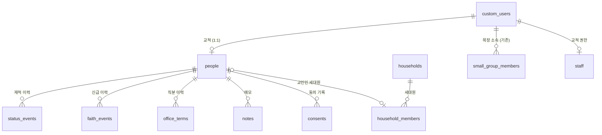

# 재적(교적) 설계 — 1차 초안

작성 2026-10-10 · 브랜치 `church-membership-finance-research` · 앞 문서: [01-research.md](01-research.md)

디모데 교적을 대체할 **재적 관리**의 설계다. 재정은 다음 문서(`03-finance-design.md`)에서 다룬다.
§9의 결정 사항과 §10의 확인 사항에 답을 받으면 2차 초안으로 고친다.

---

## 0. 한눈에 보기

1. **사람은 지금처럼 `custom_users` 한 행이다.** 교적은 그 사람에 1:1로 붙는 별도 테이블이다.
   교적 행이 있으면 "교적에 등록된 교인"이고, 없으면 앱 사용자일 뿐이다.
2. **교적 데이터는 API로 바로 읽을 수 없다.** 교적 테이블은 API에 노출되지 않는 `registry` 스키마에 두고,
   읽기와 쓰기는 모두 DB 함수(RPC)를 거친다. 그래야 함수 안에서 권한을 확인하고 **모든 조회를 접속기록으로 남길 수 있다.**
   지금 출석부처럼 화면이 테이블을 직접 조회하면 조회 기록을 남길 방법이 없다.
3. **상태·신급·직분은 이력으로 쌓고, 현재 값은 이력에서 계산한다.**
   - 재적 상태: 등록 → 재적, 보류, 전출, 별세, 제적
   - 신급: 학습, 세례, 유아세례, 입교
   - 직분: 임직, 은퇴 등
   어느 것도 덮어쓰지 않고, 영구 삭제도 없다.
4. **세대는 사람과 따로 둔다.** 교인 아닌 가족은 사람 행을 만들지 않고 이름·관계만 적는다.
5. **앱 탈퇴와 교적 삭제를 분리한다.** 지금은 앱에서 탈퇴하면 사람 행이 지워지고, 목장 소속과 출석 기록까지 함께 지워진다.
   앞으로는 교적이 있는 사람이 탈퇴하면 **계정 연결만 끊고** 교적과 출석 기록은 남긴다.
6. **사이트 관리자라고 교적을 자동으로 볼 수는 없다.** 교적 권한은 따로 부여하고, 부여·변경 이력을 남긴다.
   교적 담당자는 2단계 인증(MFA)을 쓰는 것을 권장한다.
7. **이전은 담당자가 웹 화면에서 한다.** 디모데에서 내보낸 엑셀(CSV)을 올리면, 기존 사람과 매칭하는 것을 검토한 뒤 적용한다.
   개발자는 교인 데이터의 내용을 보지 않는다.
8. **1단계 범위**
   - 교적 카드: 인적사항, 세대, 상태, 신급, 직분, 메모
   - 검색과 명단
   - 새가족 등록
   - 권한과 기록
   - 디모데 이전

   심방, 선교회 같은 기타 소속, 출력물, 교세 통계는 2단계다.

---

## 1. 지금 구조에서 출발할 때 걸리는 것 (2026-10-10 DB 확인)

| 사실 | 설계에 주는 의미 |
|---|---|
| `custom_users` 633행 = 로그인 계정(`active=true` 309)과 미가입 placeholder(324)의 혼합. placeholder도 `auth_id`에 임의 UUID가 들어 있다 | 교적의 사람 키로 `custom_users.id`를 그대로 쓸 수 있다. 다만 "교적 등록 여부"를 나타낼 별도 표시가 필요하다 → 교적 행이 있는지로 판단한다 |
| 가입 병합 `merge_user_data`: 이름+전화가 맞는 placeholder를 찾으면 관계 4종을 가입자 행으로 옮기고 **placeholder를 지운다** | 교적은 대부분 가입 전부터 있으므로 placeholder 쪽에 붙어 있다. 병합할 때 교적이 함께 옮겨지지 않으면 **CASCADE/RESTRICT 때문에 병합이 실패하거나 교적이 사라진다** (§5.1) |
| 앱 탈퇴(`delete-account`)는 `custom_users` 행을 지운다. `small_group_members`·`member_vehicles`·권한 테이블은 **CASCADE**이고, 출석 기록·특이사항은 소속 행에 CASCADE로 붙어 있다. `posts`·`comments`·`likes`는 `auth_id` 기준 CASCADE | 탈퇴하면 그 사람의 목장 소속과 **과거 출석 기록·특이사항까지** 지금도 사라진다. 교적까지 같은 길로 가면 안 된다 (§5.2) |
| 반대로 `attendance_records.recorded_by`·`member_notes.created_by`·`group_session_notes.created_by`는 NO ACTION이다 | 출석을 기록했거나 메모를 쓴 리더·교역자가 앱에서 탈퇴하면 **삭제가 오류로 실패한다**(지금 있는 문제). §5.2의 연결 끊기 방식으로 바꾸면 함께 해결된다 |
| `office`에 직분(집사 224, 권사 115, 시무집사 28, 장로 20, 목사 5, 전도사 4)과 비직분(성도 205, 사모 4, 초등·유치·영아·중등 28)이 섞여 있다 | `office`는 앱의 **표시 호칭**으로 남기고, 교적 직분은 이력 테이블에서 관리한다. 직분이 바뀌면 표시 호칭을 맞춘다 |
| 조직: `communities` 3개(열매·줄기·뿌리) → `small_groups` 29개 → `small_group_members` 536행 (리더 29) | 이것을 교적의 기본 조직(교구 → 목장)으로 쓴다. 출석부와 같은 소속을 공유한다 |
| 감사 로그 `audit_logs`: 변경 전후 행 전체를 복사하고, 실패해도 그냥 넘어가며(fail-open), 사이트 관리자는 `/logs`에서 전부 볼 수 있다 | 교적 변경을 여기에 남기면 교적 권한이 없는 사이트 관리자에게 교적이 보인다 → **교적은 별도 변경기록**을 두고, 기록에 실패하면 저장도 실패하게 한다(fail-closed) |
| 웹은 브라우저에서 anon 키 + 사용자 세션으로 직접 조회한다. 서버에는 서비스 롤 키가 없다 | 권한과 기록을 DB 함수 안에서 처리하는 방식이 지금 구조와 맞는다. 서버 경로를 새로 만들 필요가 없다 |

---

## 2. 전체 그림



- 교적 테이블(`people` 등)은 **`registry` 스키마**에 둔다. 이 스키마는 Supabase API에 노출하지 않는다.
  설령 권한 설정을 실수해도 API로는 닿지 않는다.
- 화면은 `public` 스키마의 `registry_*` 함수만 호출한다. 함수는 SECURITY DEFINER로 돌고, 처음에 권한을 확인하며,
  끝나기 전에 접속기록을 쓴다.
- 접속기록·변경기록·권한 이력은 **`privacy` 스키마**에 둔다. 재정도 나중에 같은 곳을 쓴다.

```
브라우저 ──rpc('registry_card', {person_id})──▶ public.registry_card()   [SECURITY DEFINER]
                                                 ├─ 권한 확인 (registry.staff, MFA)
                                                 ├─ registry.* 읽기
                                                 └─ privacy.access_logs 에 "누가·언제·어디서·누구를·무엇을" 기록
```

---

## 3. 데이터 모델

### 3.1 교적 — `registry.people` (사람당 1행)

| 컬럼 | 형식 | 설명 |
|---|---|---|
| `person_id` | uuid PK → `custom_users.id` | 사람 키. **ON DELETE RESTRICT, ON UPDATE CASCADE** |
| `reg_no` | text unique | 교번. 디모데 교번을 그대로 옮기고, 새로 등록하면 이어서 매긴다(결번 허용) |
| `name_note` | text | 동명이인 구분 표시. 디모데의 '홍길동C' 같은 접미사는 이름에서 떼어 여기에 둔다 |
| `birth_lunar` | boolean | 생년월일이 음력인지 여부. 생년월일 자체는 `custom_users.birth_date`를 쓴다 |
| `address_zip`, `address1`, `address2` | text | **개인 주소. 비어 있으면 세대 주소를 쓴다** |
| `occupation`, `workplace` | text | 직업, 직장·학교 |
| `marital_status` | text (코드) | 미혼·기혼·사별 등. 선택 항목 |
| `wedding_date` | date | 결혼기념일 |
| `previous_church` | text | 이전 교회와 교단 |
| `guide_person_id` / `guide_name` | uuid / text | 인도자. 교인이면 사람 키, 아니면 이름 |
| `sms_opt_out` | boolean | 문자 수신 거부 |
| `note` | text | 비고 |
| `created_at`, `updated_at`, `updated_by` | | |

**`custom_users`에 그대로 두는 것:** 이름, 전화, 성별, 생년월일, 표시 호칭(`office`), 사진.
앱과 출석부가 이미 이 컬럼을 쓰고 있어서 옮기면 다 깨진다. 교적 화면에서 고치면 같은 행이 바뀐다.
교적 함수가 직접 쓰기 때문에 `custom_users_guard` 트리거는 거치지 않는다. 따라서 권한 확인은 함수 안에서 한다.

### 3.2 세대 — `registry.households`, `registry.household_members`

| 테이블 | 주요 컬럼 |
|---|---|
| `households` | `id`, `household_no`(디모데 세대 번호 보존), `address_zip/1/2`, `home_phone`, `note` |
| `household_members` | `household_id`, `person_id`(교인이면 → `people`, 아니면 null), `name`·`birth_year`(교인이 아닐 때), `relation`(코드: 본인·배우자·자녀·부모·며느리·사위·손자녀·형제자매·기타), `sort_order`, `note` |

- 신앙세대주는 `relation = 본인`인 행이다. 한 세대에 하나만 둔다.
- 교인 한 사람은 **한 세대에만** 속한다(`person_id` unique).
- **분가·합가**는 세대원을 다른 세대로 옮기는 것이다. 옮긴 이력은 변경기록에 남는다.
- **교인이 아닌 가족**은 사람 행을 만들지 않는다. 출석부와 앱의 사람 목록이 비교인으로 채워지지 않게 하기 위해서다.
  그 가족이 나중에 교인으로 등록하면 행을 사람으로 바꾼다.

### 3.3 재적 상태 — `registry.status_events`

`person_id`, `kind`, `event_date`, `reason`, `church_name`(이명한 교회), `created_by`, `created_at`

| `kind` | 결과 상태 | 쓰는 때 |
|---|---|---|
| 등록 | **재적** | 새가족 등록 |
| 전입 | **재적** | 다른 교회에서 이명해 옴 |
| 복적 | **재적** | 보류·제적·전출 뒤 다시 출석 |
| 보류 | **보류** | 장기 결석, 연락 두절 |
| 전출 | **전출** | 이명증서 발급, 이사 |
| 별세 | **별세** | |
| 제적 | **제적** | 본인 요청, 당회 결의 |

- **현재 상태 = 가장 최근 이벤트의 결과 상태**다(`event_date`, 같은 날이면 입력 순서). 따로 저장하지 않고 계산한다.
  사람 수가 수백 명이라 매번 계산해도 비용이 없다.
- 교적 행은 있는데 이벤트가 없는 사람은 없게 한다. 등록 함수와 이전 도구가 항상 첫 이벤트를 만든다.
- 통계의 **재적 교인 수 = 상태가 재적인 사람**이다. 보류는 따로 센다. 노회 보고 기준은 §10에서 확인한다.

### 3.4 신급 — `registry.faith_events`

`person_id`, `kind`(학습·세례·유아세례·입교), `event_date`, `church_name`(비면 본 교회), `officiant`(집례자), `note`

현재 신급은 기록에서 계산한다.

| 기록 | 신급 |
|---|---|
| 세례 또는 입교 | 세례교인 (입교인 포함) |
| 유아세례만 | 유아세례교인 |
| 학습만 | 학습교인 |
| 없음 | 원입교인 |

합동 측 교회 규약 사례에서는 다음과 같이 정한다. 다만 [교회 규약 사례](https://lawinsider.com/ko/contracts/84BxZHTase9)일 뿐이고 총회 헌법 원문은 아직 확인하지 못했다. **기준은 강제하지 않고 화면에서 안내만 한다.**
- 학습: 원입 6개월 이상, 만 14세 이상
- 세례: 학습 후 6개월
- 유아세례: 만 2세 이하
- 입교: 유아세례를 받은 사람이 만 14세가 됐을 때

### 3.5 직분 — `registry.office_terms`

`person_id`, `office`(코드), `standing`(시무·은퇴·원로·명예·협동·사임), `started_on`(임직·취임일), `ended_on`, `note`

- 한 행이 "한 직분의 한 시기"다.
  - 예: 장로 임직(시무) 2000-03-05 ~ 2020-12-31 한 행
  - 은퇴 장로 2021-01-01 ~ 한 행
- 직분 코드의 기본값은 다음과 같다. 실제 쓰는 이름은 코드표(§3.8)에서 바꿀 수 있다.
  - 목사, 전도사, 장로, 안수집사, 권사, 서리집사
- 지금 데이터의 '시무집사'(28)와 '집사'(224)가 각각 안수집사와 서리집사인지는 확인해야 한다(§10).
- **표시 호칭 맞추기**: 직분 이력을 바꾸면 함수가 `custom_users.office`를 현재 가장 높은 시무 직분으로 맞춘다.
  - 직분 이력이 없는 사람의 호칭(성도, 사모, 초등 등)은 건드리지 않는다.
  - 아동 연령 구분(영아·유치·초등)은 앞으로 생년월일에서 계산한다. 기존 값은 정리 대상이다.

### 3.6 메모와 동의

| 테이블 | 컬럼 | 비고 |
|---|---|---|
| `registry.notes` | `person_id`, `body`, `created_by`, `created_at` | 담당자 메모. 고치거나 지우면 변경기록에 남는다 |
| `registry.consents` | `person_id`, `kind`, `notice_version`, `granted_on`, `method`(서면·앱·구두), `guardian_name`, `revoked_on`, `recorded_by` | `kind`: 교적 등록 / 민감정보 / 요람 공개 / 14세 미만 보호자 동의. 새가족 등록카드의 서면 동의를 담당자가 입력한다 |

### 3.7 조직

**1단계**에서는 기존 `communities` → `small_groups` → `small_group_members`를 그대로 교적의 조직으로 쓴다.
교적 카드에 현재 공동체와 목장을 보여 주고, 목장 이동은 지금처럼 출석부 관리 화면에서 한다.

**2단계**
- **선교회·교회학교 부서·찬양대·봉사팀** 같은 기타 소속을 일반 조직 테이블에 둔다.
  - `registry.org_units`: 트리 구조, 종류, 사용 여부
  - `registry.org_memberships`: 사람, 조직, 역할, 시작일, 종료일
- **목장 소속에도 기간 이력**(시작일·종료일)을 붙인다. 그러면 출석부에서 보류해 둔
  "그 주의 재적" 문제(`docs/attendance-stats.md`)도 함께 풀린다.
- 디모데처럼 **연도마다 조직을 복제하지 않고**, 기간 이력으로 연도별 편성을 표현한다.
  매년 재편성할 때는 새 조직을 만들고 옛 조직을 닫는다. 재편성 주기는 §10에서 확인한다.

### 3.8 코드표 — `registry.codes`

`category`, `code`, `label`, `sort_order`, `active`

- 직분, 세대 관계, 결혼 상태, (2단계) 심방 구분처럼 **교회가 이름을 바꿀 수 있는 목록**을 둔다.
- 재적 상태와 신급처럼 **동작이 달라지는 값**은 코드표에 두지 않고 DB 제약으로 고정한다. 이름이 바뀌어도 계산 규칙은 같아야 하기 때문이다.

---

## 4. 권한·기록·인증

### 4.1 교적 권한 — `registry.staff`

| 컬럼 | 의미 |
|---|---|
| `user_id` | 담당자 (`custom_users.id`) |
| `scope` | `all` = 전체, `communities` = 지정한 공동체만 |
| `community_ids` | `scope = communities`일 때 볼 수 있는 공동체 |
| `can_edit` | 수정·등록·상태 처리 |
| `can_export` | 내려받기·출력 |
| `can_pastoral` | (2단계) 심방 내용 열람·작성 |
| `granted_by`, `granted_at`, `note` | |

- 권장하는 기본 구성(§9 결정 1)
  - 교적 담당 간사: 전체 + 수정 + 내려받기
  - 교역자: 전체 열람 + 심방
  - 목장 리더: **교적 권한 없음** (지금 출석부 권한 그대로)
- `scope = communities`인 사람은 **현재 목장이 그 공동체에 속한 교인**만 본다. 목장이 없는 교인은 `all`만 본다.
- 권한은 사이트 관리자(레벨 100)가 부여한다. 관리자가 자기 자신에게 부여하는 것도 기록에 남는다.
- **부여·변경·해제 이력은 3년 보관**한다(안전성 확보조치 기준 제5조).
  트리거로 `privacy.permission_logs`에 쓰고, 기록에 실패하면 권한 변경도 실패한다.

### 4.2 접속기록 — `privacy.access_logs`

| 컬럼 | 내용 |
|---|---|
| `at` | 일시 |
| `actor_auth_id`, `actor_person_id`, `actor_name` | 누가 |
| `ip`, `user_agent` | 어디서. PostgREST가 넘겨주는 요청 헤더(`cf-connecting-ip`, `x-forwarded-for`)에서 읽는다 |
| `action` | 검색 / 열람 / 수정 / 등록 / 내려받기 / 출력 |
| `fn` | 호출한 함수 |
| `target_ids`, `target_count` | 누구의 정보를 |
| `detail` | 검색 조건, 내려받은 항목, **용도(내려받기·출력은 필수 입력)** |

- **추가만 된다.** 수정·삭제 권한은 아무에게도 주지 않는다. 사이트 관리자도 지울 수 없다.
- 3년 보관 후 자동으로 삭제한다(의무 2년 이상, 권한 이력 3년과 맞춤).
- 열람은 사이트 관리자(또는 개인정보 보호책임자)만 전용 화면에서 할 수 있다. 접속기록을 열람한 것도 기록한다.

### 4.3 변경기록 — `privacy.change_logs`

- 교적 테이블마다 트리거를 단다. 변경 전후 값과 바뀐 필드를 남긴다.
- 기존 `audit_logs`와 다르게 **같은 트랜잭션에서 쓰므로, 기록에 실패하면 저장도 실패한다**(fail-closed).
- 교적 권한이 있는 사람만 해당 교인 카드의 '변경 이력' 탭에서 본다. `/logs`(사이트 관리자용)에는 나오지 않는다.

### 4.4 2단계 인증(MFA)과 세션

- Supabase Auth의 TOTP를 쓴다. 무료 요금제에도 들어 있다. 로그인 토큰의 `aal` 값이 `aal2`인지로 확인한다.
- 설정 `require_mfa`를 켜면 교적 함수가 `aal2`가 아닌 호출을 거절한다(§9 결정 2).
  처음 교적 화면에 들어오면 인증 앱 등록을 안내한다.
- 교적 화면은 **30분 동안 쓰지 않으면 잠긴다.** 다시 인증해야 열린다.
- 근거: 외부에서 접속할 때 안전한 인증수단을 쓰게 한 안전성 확보조치 기준 제6조. 교회 웹은 어디서나 접속할 수 있다.

### 4.5 운영 수칙 (2026-10-31부터 개발자 접속도 기록 대상)

- 교인 데이터의 내용은 운영 DB 콘솔·MCP로 조회하지 않는다. 집계, ID, 구조만 본다(지금까지 지켜 온 방식).
- 이전과 정정은 담당자가 웹 화면에서 한다. 개발자가 SQL로 교인 행을 고쳐야 하는 일이 생기면 사유와 함께 기록한다.

---

## 5. 기존 흐름에 생기는 변경

### 5.1 가입 병합 (`merge_user_data`)

- 교적 하위 테이블은 모두 `registry.people(person_id)`를 **ON UPDATE CASCADE**로 참조한다.
  그래서 병합 함수는 `UPDATE registry.people SET person_id = 가입자 WHERE person_id = placeholder` **한 줄**만 추가하면 된다.
  세대·상태·신급·직분·메모·동의가 함께 따라간다.
- 인도자(`guide_person_id`)처럼 `custom_users`를 직접 참조하는 컬럼도 함께 옮긴다.
- **양쪽 다 교적이 있으면** 자동으로 병합하지 않고 `registry.merge_conflicts`에 남긴다. 담당자가 화면에서 처리한다.
- **위험 경로:** 이름+전화만으로 자동 병합되는 경로가 남아 있다(보안 작업의 남은 일 5번).
  1단계에서는 **본인이 자기 교적을 보는 기능을 만들지 않기 때문에** 남의 프로필을 가로채도 교적은 보이지 않는다.
  본인 열람 기능(3단계)을 열 때는 담당자가 연결을 확인하는 단계를 먼저 넣는다.

### 5.2 앱 탈퇴 (`delete-account` Edge Function)

교적 행이 있는 사람이 탈퇴하면 계정 연결만 끊는다(§9 결정 4).

1. 앱 전용 데이터를 지운다. 지금 CASCADE로 지워지는 것과 같다.
   - 게시글, 댓글, 좋아요, 문의, 그룹 가입
   - 이것들은 `auth_id`를 참조하므로, 다음 단계에서 `auth_id`를 바꾸기 전에 먼저 지워야 한다
2. `custom_users`를 미가입 상태로 되돌린다.
   - `auth_id` → 새 임의 UUID, `active = false`
   - `email`, `profile_picture`, `privacy_consented_at` 비우기, `is_info_public = false`
3. 로그인 계정(`auth.users`)을 지운다. 푸시 토큰은 이때 CASCADE로 지워진다.
4. 교적, 목장 소속, 출석 기록은 남는다. 같은 사람이 다시 가입하면 이름+전화로 다시 연결된다.

- 교적이 없는 사람은 지금처럼 행을 지운다.
  - 다만 출석을 기록한 적이 있는 리더처럼 NO ACTION 참조가 있으면 지금도 삭제가 실패한다.
  - 이런 사람도 연결 끊기로 처리하는 편이 낫다. 그러면 **"출석 기록에 연결된 사람은 행을 지우지 않는다"**가 규칙이 된다.
- Edge Function만 바꾸면 되므로 **앱을 새로 출시할 필요는 없다.**
- 개인정보 처리방침에 "앱 탈퇴는 앱 계정의 삭제이고, 교회 교적은 교회의 별도 절차(전출·제적)로 처리된다"는 문장을 넣는다.

### 5.3 앱의 교인 인증 표시 (`custom_users.member`)

- 앱 요람과 조회 정책이 `member`를 쓴다.
- 재적 상태를 바꾸는 함수가 `member`를 함께 맞추는 것을 권장한다(§9 결정 3).
  - 재적·보류 → true
  - 전출·별세·제적 → false
- 그러면 별세하거나 전출한 교인이 앱 요람에서 자동으로 빠진다.
- 교적에 없는 앱 사용자의 `member`는 지금처럼 담당자가 손으로 관리한다.

### 5.4 출석부

- 1단계에서는 바꾸지 않는다.
- 출석부의 '새 프로필 추가'는 교적 없는 사람 행을 만든다. 그 사람을 교적에 올리려면 교적 화면의 '기존 사람을 교적에 등록'을 쓴다.

---

## 6. 함수(API) — 1단계

모든 함수는 다음 순서로 동작한다.
1. 권한 확인: `registry.staff`, 범위, MFA
2. 입력 검증
3. 처리
4. 접속기록

| 함수 | 하는 일 | 기록 |
|---|---|---|
| `registry_search(filters, page)` | 조건 검색: 이름(여러 명 동시), 상태, 신급, 직분, 공동체·목장, 성별, 나이대, 등록일 기간. 목록에 필요한 열만 돌려준다 | 검색 조건 + 결과 사람 ID |
| `registry_card(person_id)` | 교적 카드 전체(인적사항, 세대, 이력, 메모, 동의)를 JSON 하나로 | 열람 |
| `registry_save(person_id, patch)` | 인적사항 수정. `custom_users` 쪽 필드와 `people` 쪽 필드를 함께 받는다 | 수정 + 변경기록 |
| `registry_register(data)` | **새가족 등록**: 사람 행(미가입 상태) + 교적 + '등록' 이벤트 + 동의를 한 번에 | 등록 |
| `registry_enroll(person_id, data)` | 이미 있는 사람(앱 가입자, 출석부 프로필)을 교적에 올림 | 등록 |
| `registry_add_status` / `registry_add_faith` / `registry_set_office` | 이력 추가. 상태는 `member`, 직분은 `office`를 함께 맞춤 | 수정 |
| `registry_household_*` | 세대 만들기, 세대원 추가·이동·관계 변경, 분가 | 수정 |
| `registry_export(filters, columns, purpose)` | 내려받기용 행. **용도 필수**, 고른 열만 | 내려받기 |
| `registry_print(person_ids, kind, purpose)` | 출력 전에 기록만 남김. 인쇄는 브라우저가 한다 | 출력 |
| `registry_import_*` | 이전 도구 (§8) | 등록 |
| `privacy_access_logs(filters)` | 접속기록 열람 (관리자) | 열람 |

---

## 7. 화면 — 1단계

| 경로 | 화면 | 대상 |
|---|---|---|
| `/registry` | 교인 목록. 왼쪽에 조건(상태·신급·직분·공동체·목장 트리), 오른쪽에 표. 이름 여러 개를 쉼표로 동시 검색 | 교적 권한자 |
| `/registry/[id]` | 교적 카드. 탭 구성: 기본 정보 · 세대 · 신앙(신급·직분) · 재적 이력 · 메모 · 동의 · 변경 이력 | 교적 권한자 |
| `/registry/new` | 새가족 등록. 등록카드 순서대로 입력하고, 같은 이름·전화번호가 있으면 먼저 보여 준다 | 수정 권한자 |
| `/registry/import` | 디모데 이전 | 수정 권한자 |
| `/registry/access-logs` | 접속기록 | 사이트 관리자 |

- 상단 메뉴에 '교적'을 넣는다. 교적 권한이 있는 사람에게만 보인다. 주차 관리 메뉴와 같은 방식이다.
- 데스크톱을 먼저 고려하고, 휴대폰에서는 카드 열람과 간단한 수정만 지원한다.
- 내려받기는 기존 `src/lib/csv.ts`(엑셀 호환 CSV)를 쓴다. 누르면 용도를 입력하는 창이 먼저 나온다.

---

## 8. 디모데 이전

1. **확보**: 디모데 교적의 '전체 항목' 엑셀을 받는다. 우선 **열 이름(머리글)만** 받아서 매핑표를 만든다.
   세대 번호, 교번, 이력 탭(심방·직분·교인구분)이 들어 있는지를 본다. 원본 DB 백업 요청도 함께 진행한다.
2. **올리기**: 담당자가 `/registry/import`에 CSV를 올린다. 엑셀에서 "CSV UTF-8"로 저장한 파일이다.
   브라우저가 파일을 읽어서 행 단위로 `registry.import_rows`(일괄 번호, 원본 JSON, 매칭 결과)에 넣는다.
3. **매칭**: 이름+전화(숫자만)+생년월일로 기존 `custom_users`를 찾는다. 결과는 세 가지다.
   - 하나만 일치
   - 후보가 여럿
   - 새로 만듦

   담당자가 후보를 고른다. 2026-06의 동명이인 정리 방식을 재사용한다.
4. **적용**: 확정한 행만 교적·세대·이벤트로 만든다.
   - 교번·세대 번호는 디모데 값을 그대로 쓴다.
   - 등록일은 '등록' 이벤트로, 교인구분은 상태 이벤트로, 신급·직분은 각 이력으로 만든다.
   - 원본 행은 일괄 번호와 함께 남아서 나중에 대조할 수 있다.
5. **대조**: 상태별·신급별·직분별 인원을 디모데 통계 화면 숫자와 맞춰 본다.
6. **병행 운영**: 한두 달 두 시스템을 같이 쓰다가 디모데를 해지한다. 해지 날짜는 계약 갱신일에 맞춘다(§10).

- 주민번호 열이 있으면 **올리기 단계에서 버린다.** 재정 설계에서 따로 다룬다.
- 이전 도구도 교적 함수와 같은 권한 확인과 접속기록을 거친다.

---

## 9. 결정이 필요한 것

| # | 결정 | 권장안 | 다른 안 |
|---|---|---|---|
| 1 | 교적 열람 범위 | 교적 담당 간사: 전체 수정. 교역자: 전체 열람. 리더: 없음 | 교역자는 담당 공동체만 / 교적 담당자만 |
| 2 | 2단계 인증 | 교적 권한자 전원 필수 | 처음엔 권장하고 나중에 필수 / 안 함 |
| 3 | 재적 상태와 앱의 교인 인증(`member`) | 상태를 바꿀 때 자동으로 맞춤 | 따로 관리 |
| 4 | 교적이 있는 사람의 앱 탈퇴 | 계정 연결만 끊고 교적·출석 기록은 남김 | 지금처럼 모두 삭제 |
| 5 | 교적에 개인 주소와 세대 주소를 둘 다 둘 것인가 | 세대 주소가 기본, 개인 주소는 다를 때만 | 개인 주소만 |
| 6 | 전출·제적된 교인 기록의 보존 | 이름·교번·이력은 보존하고, 연락처·주소는 N년 뒤 지움 | 전부 영구 보존 / 일정 기간 뒤 전부 파기 |

## 10. 교회 사무실에 확인할 것 (재적 관련)

- [ ] 교적을 다루는 사람: 사무 간사 몇 명, 교역자 몇 명, 공동체(열매·줄기·뿌리)별 담당 교역자가 있는지
- [ ] 디모데 교적 '전체 항목' 엑셀의 **열 이름 목록** (데이터 없이 머리글만)
- [ ] 디모데에서 실제로 쓰는 교인구분 값과 단계 (예: 장년/청년/교회학교, 새가족/등록)
- [ ] 직분 체계: 지금 데이터의 '시무집사'와 '집사'가 각각 안수집사와 서리집사인지, 은퇴·원로·명예 직분을 기록하는지
- [ ] 목장 재편성 주기 (매년 1월인지, 수시인지)
- [ ] 새가족 절차: 등록카드 항목, 새가족 교육 과정과 수료 기준, 정착 판정
- [ ] 노회에 내는 교세 통계 양식 (합동 노회 서식)
- [ ] 교적부·교인증명서·세례증명서 실물 양식
- [ ] 디모데 계약 갱신일 (병행 운영과 해지 일정의 기준)

---

## 11. 단계와 작업 순서

**1단계 — 교적 기반**
1. 마이그레이션 ①
   - `registry`·`privacy` 스키마
   - 권한(`staff`)과 권한 이력, 접속기록, 변경기록
   - 권한 확인 헬퍼, MFA 설정
2. 마이그레이션 ②
   - 교적·세대·이력·코드표·동의 테이블
   - `registry_*` 함수
3. 마이그레이션 ③
   - 병합 함수에 교적 이관 추가
   - `delete-account` 연결 끊기 (Flutter 저장소의 Edge Function)
4. 웹 화면
   - 목록·검색, 교적 카드, 새가족 등록, 세대 편집
   - MFA 등록, 상단 메뉴
5. 이전 도구, 디모데 데이터로 시험 이전과 대조
6. 개인정보 처리방침 개정: 교적 항목, 탈퇴와 교적의 관계, 접속기록. **7일 전 공지**
7. 검증: 역할별(교적 담당·교역자·공동체 담당·리더·교인·비로그인) 접근 테스트 SQL을 저장소(`supabase/tests/`)에 두고,
   보안 작업 때처럼 롤백 트랜잭션으로 돌린다

**2단계 — 목양 기능**
- 심방 기록. 열람 범위는 전체 / 교역자 / 작성자 중에서 고른다
- 기타 소속(선교회 등)과 목장 소속 기간 이력. 출석부의 시점별 재적 문제도 여기서 함께 해결한다
- 출력물: 교적부, 교인증명서, 세례증명서, 주소 라벨, 요람
- 통계: 상태·신급·직분·성별·연령대·공동체별 인원, 기간별 등록·전출·별세, 노회 교세 보고 양식

**3단계 — 교인 쪽**
- 앱에서 본인 교적 보기와 정보 수정 요청. 담당자의 연결 확인이 먼저다
- 생일·기념일 명단과 알림
- 출석 연동: 장기 결석자를 보류 후보로 제시
- 문자 발송

**선행 조건:** 브랜치 `fix-custom-users-rls`(보안 정책)가 main에 먼저 들어가야 한다.
이 설계의 조회 정책과 `supabase/migrations/` 폴더가 그 브랜치에서 시작된다.
