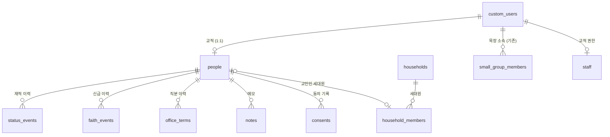

# 재적(교적) 설계 — 1차 초안

작성 2026-10-10 · 브랜치 `church-membership-finance-research` · 앞 문서: [01-research.md](01-research.md)

디모데 교적을 대체할 **재적 관리**의 설계다. 재정은 다음 문서(`03-finance-design.md`)에서 다룬다.
§9의 결정 사항과 §10의 확인 사항에 답을 받으면 2차 초안으로 고친다.

---

## 0. 한눈에 보기

1. **사람은 지금처럼 `custom_users` 한 행이다.** 교적은 그 사람에 1:1로 붙는 별도 테이블이다.
   교적 행이 있으면 "교적에 등록된 교인"이고, 없으면 앱 사용자일 뿐이다.
2. **교적 데이터는 API로 바로 읽을 수 없다.** 교적 테이블은 API에 노출되지 않는 `registry` 스키마에 두고,
   읽기와 쓰기는 모두 DB 함수(RPC)를 거친다. 그래야 함수 안에서 권한을 확인하고 **모든 조회를 접속기록으로 남길 수 있다.**
   지금 출석부처럼 화면이 테이블을 직접 조회하면 조회 기록을 남길 방법이 없다.
3. **상태·신급·직분은 이력으로 쌓고, 현재 값은 이력에서 계산한다.**
   - 재적 상태: 등록 → 재적, 보류, 전출, 별세, 제적
   - 신급: 학습, 세례, 유아세례, 입교
   - 직분: 임직, 은퇴 등
   어느 것도 덮어쓰지 않고, 영구 삭제도 없다.
4. **세대는 사람과 따로 둔다.** 교인 아닌 가족은 사람 행을 만들지 않고 이름·관계만 적는다.
5. **앱 탈퇴와 교적 삭제를 분리한다.** 지금은 앱에서 탈퇴하면 사람 행이 지워지고, 목장 소속과 출석 기록까지 함께 지워진다.
   앞으로는 교적이 있는 사람이 탈퇴하면 **계정 연결만 끊고** 교적과 출석 기록은 남긴다.
6. **사이트 관리자라고 교적을 자동으로 볼 수는 없다.** 교적 권한은 따로 부여하고, 부여·변경 이력을 남긴다.
   교적 담당자는 2단계 인증(MFA)을 쓰는 것을 권장한다.
7. **초기 교적은 기존 프로필에서 만든다.** 디모데는 실제로 거의 쓰지 않아 가져올 자료가 없다(2026-10-10 확인).
   출석부를 만들 때 미리 입력한 교인 정보가 가장 완전하므로, 지금 목장에 속한 교인 526명의 교적을 한 번에 만든다.
   주소·가족·신급은 그 뒤에 채운다. 개발자는 교인 데이터의 내용을 보지 않고 집계로만 확인한다.
8. **1단계 범위**
   - 교적 카드: 인적사항, 세대, 상태, 신급, 직분, 메모
   - 검색과 명단
   - 새가족 등록
   - 권한과 기록
   - 기존 프로필에서 교적 생성

   심방, 선교회 같은 기타 소속, 출력물, 교세 통계는 2단계다.

---

## 1. 지금 구조에서 출발할 때 걸리는 것 (2026-10-10 DB 확인)

| 사실 | 설계에 주는 의미 |
|---|---|
| `custom_users` 633행 (2026-10-10 집계)<br>• 미리 입력한 교인 324 (`active=false`, 로그인 없음, 출석부를 만들 때 담당자가 넣음. 전화 315·생년월일 320 채워짐)<br>• 가입한 교인 172 (`member=true`, 로그인 있음)<br>• 출석부 '새 프로필 추가'로 만든 사람 81 (`active=true`인데 로그인 없음, 전화·생년월일 없음)<br>• 교인 인증이 안 된 가입자 56<br>미가입 행도 `auth_id`에 임의 UUID가 들어 있다 | **교인은 이미 거의 다 들어 있다**(`member=true` 577). 교적은 이 사람들로 바로 만든다(§8). 교적 등록 여부는 교적 행이 있는지로 판단한다 |
| 출석부 '새 프로필 추가'는 `active=true`로 넣는다 (`src/routes/attendance/manage/+page.svelte:188`) | 가입 병합은 `active=false` + 전화번호가 맞는 행만 찾으므로, 이 81명은 **가입해도 자동으로 합쳐지지 않는다**. 가입하면 같은 사람이 둘이 되고 출석 기록은 옛 행에 남는다 → 담당자가 손으로 잇는 '계정 연결'이 필요하다(§5.1) |
| 가입 병합 `merge_user_data`: 이름+전화가 맞는 placeholder를 찾으면 관계 4종을 가입자 행으로 옮기고 **placeholder를 지운다** | 교적은 대부분 가입 전부터 있으므로 placeholder 쪽에 붙어 있다. 병합할 때 교적이 함께 옮겨지지 않으면 **CASCADE/RESTRICT 때문에 병합이 실패하거나 교적이 사라진다** (§5.1) |
| 앱 탈퇴(`delete-account`)는 `custom_users` 행을 지운다. `small_group_members`·`member_vehicles`·권한 테이블은 **CASCADE**이고, 출석 기록·특이사항은 소속 행에 CASCADE로 붙어 있다. `posts`·`comments`·`likes`는 `auth_id` 기준 CASCADE | 탈퇴하면 그 사람의 목장 소속과 **과거 출석 기록·특이사항까지** 지금도 사라진다. 교적까지 같은 길로 가면 안 된다 (§5.2) |
| 반대로 `attendance_records.recorded_by`·`member_notes.created_by`·`group_session_notes.created_by`는 NO ACTION이다 | 출석을 기록했거나 메모를 쓴 리더·교역자가 앱에서 탈퇴하면 **삭제가 오류로 실패한다**(지금 있는 문제). §5.2의 연결 끊기 방식으로 바꾸면 함께 해결된다 |
| `office`에 직분(집사 224, 권사 115, 시무집사 28, 장로 20, 목사 5, 전도사 4)과 비직분(성도 205, 사모 4, 초등·유치·영아·중등 28)이 섞여 있다 | `office`는 앱의 **표시 호칭**으로 남기고, 교적 직분은 이력 테이블에서 관리한다. 직분이 바뀌면 표시 호칭을 맞춘다 |
| 조직: `communities` 3개(열매·줄기·뿌리) → `small_groups` 29개 → `small_group_members` 536행 (리더 29) | 이것을 교적의 기본 조직(교구 → 목장)으로 쓴다. 출석부와 같은 소속을 공유한다 |
| 감사 로그 `audit_logs`: 변경 전후 행 전체를 복사하고, 실패해도 그냥 넘어가며(fail-open), 사이트 관리자는 `/logs`에서 전부 볼 수 있다 | 교적 변경을 여기에 남기면 교적 권한이 없는 사이트 관리자에게 교적이 보인다 → **교적은 별도 변경기록**을 두고, 기록에 실패하면 저장도 실패하게 한다(fail-closed) |
| 웹은 브라우저에서 anon 키 + 사용자 세션으로 직접 조회한다. 서버에는 서비스 롤 키가 없다 | 권한과 기록을 DB 함수 안에서 처리하는 방식이 지금 구조와 맞는다. 서버 경로를 새로 만들 필요가 없다 |

---

## 2. 전체 그림



- 교적 테이블(`people` 등)은 **`registry` 스키마**에 둔다. 이 스키마는 Supabase API에 노출하지 않는다.
  설령 권한 설정을 실수해도 API로는 닿지 않는다.
- 화면은 `public` 스키마의 `registry_*` 함수만 호출한다. 함수는 SECURITY DEFINER로 돌고, 처음에 권한을 확인하며,
  끝나기 전에 접속기록을 쓴다.
- 접속기록·변경기록·권한 이력은 **`privacy` 스키마**에 둔다. 재정도 나중에 같은 곳을 쓴다.

```
브라우저 ──rpc('registry_card', {person_id})──▶ public.registry_card()   [SECURITY DEFINER]
                                                 ├─ 권한 확인 (registry.staff, MFA)
                                                 ├─ registry.* 읽기
                                                 └─ privacy.access_logs 에 "누가·언제·어디서·누구를·무엇을" 기록
```

---

## 3. 데이터 모델

### 3.1 교적 — `registry.people` (사람당 1행)

| 컬럼 | 형식 | 설명 |
|---|---|---|
| `person_id` | uuid PK → `custom_users.id` | 사람 키. **ON DELETE RESTRICT, ON UPDATE CASCADE** |
| `reg_no` | text unique, 비울 수 있음 | 교번. **처음에는 비워 둔다**(§9 결정 7). 재정(헌금 입력)을 시작할 때 매기고, 그 뒤로는 새로 등록할 때 이어서 매긴다(결번 허용) |
| `name_note` | text | 동명이인 구분 표시 (예: 출생연도, 소속). 이름 자체에 기호를 붙이지 않는다 |
| `faith_checked_on` | date | 신급을 확인한 날. 학습·세례 기록이 없을 때 '원입'과 '미확인'을 가른다(§3.4) |
| `birth_lunar` | boolean | 생년월일이 음력인지 여부. 생년월일 자체는 `custom_users.birth_date`를 쓴다 |
| `address_zip`, `address1`, `address2` | text | **개인 주소. 비어 있으면 세대 주소를 쓴다** |
| `occupation`, `workplace` | text | 직업, 직장·학교 |
| `marital_status` | text (코드) | 미혼·기혼·사별 등. 선택 항목 |
| `wedding_date` | date | 결혼기념일 |
| `previous_church` | text | 이전 교회와 교단 |
| `guide_person_id` / `guide_name` | uuid / text | 인도자. 교인이면 사람 키, 아니면 이름 |
| `sms_opt_out` | boolean | 문자 수신 거부 |
| `note` | text | 비고 |
| `created_at`, `updated_at`, `updated_by` | | |

**`custom_users`에 그대로 두는 것:** 이름, 전화, 성별, 생년월일, 표시 호칭(`office`), 사진.
앱과 출석부가 이미 이 컬럼을 쓰고 있어서 옮기면 다 깨진다. 교적 화면에서 고치면 같은 행이 바뀐다.
교적 함수가 직접 쓰기 때문에 `custom_users_guard` 트리거는 거치지 않는다. 따라서 권한 확인은 함수 안에서 한다.

### 3.2 세대 — `registry.households`, `registry.household_members`

| 테이블 | 주요 컬럼 |
|---|---|
| `households` | `id`, `household_no`(세대 번호), `address_zip/1/2`, `home_phone`, `note` |
| `household_members` | `household_id`, `person_id`(교인이면 → `people`, 아니면 null), `name`·`birth_year`(교인이 아닐 때), `relation`(코드: 본인·배우자·자녀·부모·며느리·사위·손자녀·형제자매·기타), `sort_order`, `note` |

- 신앙세대주는 `relation = 본인`인 행이다. 한 세대에 하나만 둔다.
- 교인 한 사람은 **한 세대에만** 속한다(`person_id` unique).
- **분가·합가**는 세대원을 다른 세대로 옮기는 것이다. 옮긴 이력은 변경기록에 남는다.
- **교인이 아닌 가족**은 사람 행을 만들지 않는다. 출석부와 앱의 사람 목록이 비교인으로 채워지지 않게 하기 위해서다.
  그 가족이 나중에 교인으로 등록하면 행을 사람으로 바꾼다.

### 3.3 재적 상태 — `registry.status_events`

`person_id`, `kind`, `event_date`, `reason`, `church_name`(이명한 교회), `created_by`, `created_at`

| `kind` | 결과 상태 | 쓰는 때 |
|---|---|---|
| 등록 | **재적** | 새가족 등록 |
| 전입 | **재적** | 다른 교회에서 이명해 옴 |
| 복적 | **재적** | 보류·제적·전출 뒤 다시 출석 |
| 보류 | **보류** | 장기 결석, 연락 두절 |
| 전출 | **전출** | 이명증서 발급, 이사 |
| 별세 | **별세** | |
| 제적 | **제적** | 본인 요청, 당회 결의 |

- **현재 상태 = 가장 최근 이벤트의 결과 상태**다(`event_date`, 같은 날이면 입력 순서). 따로 저장하지 않고 계산한다.
  사람 수가 수백 명이라 매번 계산해도 비용이 없다.
- 교적 행은 있는데 이벤트가 없는 사람은 없게 한다. 등록 함수와 초기 생성(§8)이 항상 첫 이벤트를 만든다.
- `event_date`는 비울 수 있다(**날짜 미상**). 초기 생성한 교인의 '등록'이 그렇다. 기간별 통계에서는 '미상'으로 따로 센다.
- 통계의 **재적 교인 수 = 상태가 재적인 사람**이다. 보류는 따로 센다. 노회 보고 기준은 §10에서 확인한다.

### 3.4 신급 — `registry.faith_events`

`person_id`, `kind`(학습·세례·유아세례·입교), `event_date`, `church_name`(비면 본 교회), `officiant`(집례자), `note`

현재 신급은 기록에서 계산한다.

| 기록 | 신급 |
|---|---|
| 세례 또는 입교 | 세례교인 (입교인 포함) |
| 유아세례만 | 유아세례교인 |
| 학습만 | 학습교인 |
| 없음 + 신급 확인일(`faith_checked_on`) 있음 | 원입교인 |
| 없음 | **미확인** |

기록이 없다는 것과 원입교인이라는 것은 다르다. 그래서 기록이 없으면 '미확인'으로 보여 준다.
초기 생성한 교인은 모두 미확인에서 시작하고, 담당자가 확인하는 대로 채운다.

합동 측 교회 규약 사례에서는 다음과 같이 정한다. 다만 [교회 규약 사례](https://lawinsider.com/ko/contracts/84BxZHTase9)일 뿐이고 총회 헌법 원문은 아직 확인하지 못했다. **기준은 강제하지 않고 화면에서 안내만 한다.**
- 학습: 원입 6개월 이상, 만 14세 이상
- 세례: 학습 후 6개월
- 유아세례: 만 2세 이하
- 입교: 유아세례를 받은 사람이 만 14세가 됐을 때

### 3.5 직분 — `registry.office_terms`

`person_id`, `office`(코드), `standing`(시무·은퇴·원로·명예·협동·사임), `started_on`(임직·취임일), `ended_on`, `note`

- 한 행이 "한 직분의 한 시기"다.
  - 예: 장로 임직(시무) 2000-03-05 ~ 2020-12-31 한 행
  - 은퇴 장로 2021-01-01 ~ 한 행
- 직분 코드의 기본값은 다음과 같다(§9 결정 8). 실제 쓰는 이름은 코드표(§3.8)에서 바꿀 수 있다.
  - 목사, 전도사, 장로, **시무집사**, 권사, **서리집사**
  - 이 교회는 '안수집사'라는 말을 쓰지 않고 '시무집사'로 통일한다.
  - 서리집사의 표시 호칭은 지금처럼 '집사'다.
- 지금 프로필의 호칭 중 직분인 것은 초기 생성 때 직분 이력 한 건으로 만든다(시무, 임직일 미상, §8).
  - 호칭 '시무집사'는 시무집사로, '집사'는 서리집사로 넣는다.
- **표시 호칭 맞추기**: 직분 이력을 바꾸면 함수가 `custom_users.office`를 현재 가장 높은 시무 직분으로 맞춘다.
  - 직분 이력이 없는 사람의 호칭(성도, 사모, 초등 등)은 건드리지 않는다.
  - 아동 연령 구분(영아·유치·초등)은 앞으로 생년월일에서 계산한다. 기존 값은 정리 대상이다.

### 3.6 메모와 동의

| 테이블 | 컬럼 | 비고 |
|---|---|---|
| `registry.notes` | `person_id`, `body`, `created_by`, `created_at` | 담당자 메모. 고치거나 지우면 변경기록에 남는다 |
| `registry.consents` | `person_id`, `kind`, `notice_version`, `granted_on`, `method`(서면·앱·구두), `guardian_name`, `revoked_on`, `recorded_by` | `kind`: 교적 등록 / 민감정보 / 요람 공개 / 14세 미만 보호자 동의. 새가족 등록카드의 서면 동의를 담당자가 입력한다 |

### 3.7 조직

**1단계**에서는 기존 `communities` → `small_groups` → `small_group_members`를 그대로 교적의 조직으로 쓴다.
교적 카드에 현재 공동체와 목장을 보여 주고, 목장 이동은 지금처럼 출석부 관리 화면에서 한다.

**2단계**
- **선교회·교회학교 부서·찬양대·봉사팀** 같은 기타 소속을 일반 조직 테이블에 둔다.
  - `registry.org_units`: 트리 구조, 종류, 사용 여부
  - `registry.org_memberships`: 사람, 조직, 역할, 시작일, 종료일
- **목장 소속에도 기간 이력**(시작일·종료일)을 붙인다. 그러면 출석부에서 보류해 둔
  "그 주의 재적" 문제(`docs/attendance-stats.md`)도 함께 풀린다.
- 디모데처럼 **연도마다 조직을 복제하지 않고**, 기간 이력으로 연도별 편성을 표현한다.
  매년 재편성할 때는 새 조직을 만들고 옛 조직을 닫는다. 재편성 주기는 §10에서 확인한다.

### 3.8 코드표 — `registry.codes`

`category`, `code`, `label`, `title`, `sort_order`, `active`

`title`은 직분의 표시 호칭이다. 예를 들어 직분 '서리집사'의 호칭은 '집사'다. 앱에 보이는 `custom_users.office`는 이 값으로 맞춘다.

- 직분, 세대 관계, 결혼 상태, (2단계) 심방 구분처럼 **교회가 이름을 바꿀 수 있는 목록**을 둔다.
- 재적 상태와 신급처럼 **동작이 달라지는 값**은 코드표에 두지 않고 DB 제약으로 고정한다. 이름이 바뀌어도 계산 규칙은 같아야 하기 때문이다.

---

## 4. 권한·기록·인증

### 4.1 교적 권한 — `registry.staff`

| 컬럼 | 의미 |
|---|---|
| `user_id` | 담당자 (`custom_users.id`) |
| `scope` | `all` = 전체, `communities` = 지정한 공동체만 |
| `community_ids` | `scope = communities`일 때 볼 수 있는 공동체 |
| `can_edit` | 수정·등록·상태 처리 |
| `can_export` | 내려받기·출력 |
| `can_pastoral` | (2단계) 심방 내용 열람·작성 |
| `granted_by`, `granted_at`, `note` | |

- 기본 구성(§9 결정 1, 2026-10-10 결정)
  - 교적 담당 간사: 전체 + 수정 + 내려받기
  - 교역자: 전체 열람 + 심방
  - 목장 리더: **교적 권한 없음** (지금 출석부 권한 그대로)
- `scope = communities`인 사람은 **현재 목장이 그 공동체에 속한 교인**만 본다. 목장이 없는 교인은 `all`만 본다.
- 권한은 사이트 관리자(레벨 100)가 부여한다. 관리자가 자기 자신에게 부여하는 것도 기록에 남는다.
- **부여·변경·해제 이력은 3년 보관**한다(안전성 확보조치 기준 제5조).
  트리거로 `privacy.permission_logs`에 쓰고, 기록에 실패하면 권한 변경도 실패한다.

### 4.2 접속기록 — `privacy.access_logs`

| 컬럼 | 내용 |
|---|---|
| `at` | 일시 |
| `actor_auth_id`, `actor_person_id`, `actor_name` | 누가 |
| `ip`, `user_agent` | 어디서. PostgREST가 넘겨주는 요청 헤더(`cf-connecting-ip`, `x-forwarded-for`)에서 읽는다 |
| `action` | 검색 / 열람 / 수정 / 등록 / 내려받기 / 출력 |
| `fn` | 호출한 함수 |
| `target_ids`, `target_count` | 누구의 정보를 |
| `detail` | 검색 조건, 내려받은 항목, **용도(내려받기·출력은 필수 입력)** |

- **추가만 된다.** 수정·삭제 권한은 아무에게도 주지 않는다. 사이트 관리자도 지울 수 없다.
- 3년 보관 후 매월 자동으로 삭제한다(의무 2년 이상, 권한 이력 3년과 맞춤). 기간이 안 지난 행은 정리 작업도 지우지 못한다.
- **거절된 호출은 남지 않는다.** 권한이 없어 함수가 오류를 내면 그 트랜잭션 전체가 되돌려지기 때문이다.
  실패한 요청은 Supabase API 로그에 남으므로, 반복된 거절을 살펴볼 때는 그쪽을 본다.
- 열람은 사이트 관리자(또는 개인정보 보호책임자)만 전용 화면에서 할 수 있다. 접속기록을 열람한 것도 기록한다.

### 4.3 변경기록 — `privacy.change_logs`

- 교적 테이블마다 트리거를 단다. 변경 전후 값과 바뀐 필드를 남긴다.
- 기존 `audit_logs`와 다르게 **같은 트랜잭션에서 쓰므로, 기록에 실패하면 저장도 실패한다**(fail-closed).
- 교적 권한이 있는 사람만 해당 교인 카드의 '변경 이력' 탭에서 본다. `/logs`(사이트 관리자용)에는 나오지 않는다.

### 4.4 2단계 인증(MFA)과 세션

- Supabase Auth의 TOTP를 쓴다. 무료 요금제에도 들어 있다. 로그인 토큰의 `aal` 값이 `aal2`인지로 확인한다.
- 교적 함수는 `aal2`가 아닌 호출을 거절한다(§9 결정 2: 처음부터 필수). 설정 `require_mfa`는 장애 대응용 스위치로만 둔다.
  처음 교적 화면에 들어오면 인증 앱 등록을 안내한다.
- 교적 화면은 **30분 동안 쓰지 않으면 잠긴다.** 다시 인증해야 열린다.
- 근거: 외부에서 접속할 때 안전한 인증수단을 쓰게 한 안전성 확보조치 기준 제6조. 교회 웹은 어디서나 접속할 수 있다.

### 4.5 운영 수칙 (2026-10-31부터 개발자 접속도 기록 대상)

- 교인 데이터의 내용은 운영 DB 콘솔·MCP로 조회하지 않는다. 집계, ID, 구조만 본다(지금까지 지켜 온 방식).
- 이전과 정정은 담당자가 웹 화면에서 한다. 개발자가 SQL로 교인 행을 고쳐야 하는 일이 생기면 사유와 함께 기록한다.

---

## 5. 기존 흐름에 생기는 변경

### 5.1 가입 병합 (`merge_user_data`)

- 교적 하위 테이블은 모두 `registry.people(person_id)`를 **ON UPDATE CASCADE**로 참조한다.
  그래서 병합 함수는 `UPDATE registry.people SET person_id = 가입자 WHERE person_id = placeholder` **한 줄**만 추가하면 된다.
  세대·상태·신급·직분·메모·동의가 함께 따라간다.
- 인도자(`guide_person_id`)처럼 `custom_users`를 직접 참조하는 컬럼도 함께 옮긴다.
- **양쪽 다 교적이 있으면** 자동으로 병합하지 않고 `registry.merge_conflicts`에 남긴다. 담당자가 화면에서 처리한다.
- **계정 연결 (수동)**: 자동 병합은 이름과 전화번호가 정확히 맞아야 한다. 그래서 담당자가 "이 가입자 = 이 교인"을 직접 고르는 기능을 둔다. 자동 병합과 같은 이관을 한다.
  - 출석부에서 전화번호 없이 만든 81명(§1)
  - 가입할 때 이름이나 번호를 다르게 적은 사람
- 출석부 '새 프로필 추가'는 앞으로 `active=false`(미가입)로 만들고 전화번호도 받게 바꾼다. 기존 81명은 `active=false`로 정리한다.
- **위험 경로:** 이름+전화만으로 자동 병합되는 경로가 남아 있다(보안 작업의 남은 일 5번).
  1단계에서는 **본인이 자기 교적을 보는 기능을 만들지 않기 때문에** 남의 프로필을 가로채도 교적은 보이지 않는다.
  본인 열람 기능(3단계)을 열 때는 담당자가 연결을 확인하는 단계를 먼저 넣는다.

### 5.2 앱 탈퇴 (`delete-account` Edge Function)

교적 행이 있는 사람이 탈퇴하면 계정 연결만 끊는다(§9 결정 4).

1. 앱 전용 데이터를 지운다. 지금 CASCADE로 지워지는 것과 같다.
   - 게시글, 댓글, 좋아요, 문의, 그룹 가입
   - 이것들은 `auth_id`를 참조하므로, 다음 단계에서 `auth_id`를 바꾸기 전에 먼저 지워야 한다
2. `custom_users`를 미가입 상태로 되돌린다.
   - `auth_id` → 새 임의 UUID, `active = false`
   - `email`, `profile_picture`, `privacy_consented_at` 비우기, `is_info_public = false`
3. 로그인 계정(`auth.users`)을 지운다. 푸시 토큰은 이때 CASCADE로 지워진다.
4. 교적, 목장 소속, 출석 기록은 남는다. 같은 사람이 다시 가입하면 이름+전화로 다시 연결된다.

- 교적이 없는 사람은 지금처럼 행을 지운다.
  - 다만 출석을 기록한 적이 있는 리더처럼 NO ACTION 참조가 있으면 지금도 삭제가 실패한다.
  - 이런 사람도 연결 끊기로 처리하는 편이 낫다. 그러면 **"출석 기록에 연결된 사람은 행을 지우지 않는다"**가 규칙이 된다.
- Edge Function만 바꾸면 되므로 **앱을 새로 출시할 필요는 없다.**
- 개인정보 처리방침에 "앱 탈퇴는 앱 계정의 삭제이고, 교회 교적은 교회의 별도 절차(전출·제적)로 처리된다"는 문장을 넣는다.

### 5.3 앱의 교인 인증 표시 (`custom_users.member`)

- 앱 요람과 조회 정책이 `member`를 쓴다.
- 재적 상태를 바꾸는 함수가 `member`를 함께 맞춘다(§9 결정 3).
  - 재적·보류 → true
  - 전출·별세·제적 → false
- 그러면 별세하거나 전출한 교인이 앱 요람에서 자동으로 빠진다.
- 교적에 없는 앱 사용자의 `member`는 지금처럼 담당자가 손으로 관리한다.

### 5.4 출석부

- 1단계에서는 바꾸지 않는다.
- 출석부의 '새 프로필 추가'는 교적 없는 사람 행을 만든다. 그 사람을 교적에 올리려면 교적 화면의 '기존 사람을 교적에 등록'을 쓴다.

---

## 6. 함수(API) — 1단계

모든 함수는 다음 순서로 동작한다.
1. 권한 확인: `registry.staff`, 범위, MFA
2. 입력 검증
3. 처리
4. 접속기록

| 함수 | 하는 일 | 기록 |
|---|---|---|
| `registry_search(filters, page)` | 조건 검색: 이름(여러 명 동시), 상태, 신급, 직분, 공동체·목장, 성별, 나이대, 등록일 기간. 목록에 필요한 열만 돌려준다 | 검색 조건 + 결과 사람 ID |
| `registry_card(person_id)` | 교적 카드 전체(인적사항, 세대, 이력, 메모, 동의)를 JSON 하나로 | 열람 |
| `registry_save(person_id, patch)` | 인적사항 수정. `custom_users` 쪽 필드와 `people` 쪽 필드를 함께 받는다 | 수정 + 변경기록 |
| `registry_register(data)` | **새가족 등록**: 사람 행(미가입 상태) + 교적 + '등록' 이벤트 + 동의를 한 번에 | 등록 |
| `registry_enroll(person_id, data)` | 이미 있는 사람(앱 가입자, 출석부 프로필)을 교적에 올림 | 등록 |
| `registry_link_account(person_id, account_id)` | 계정 연결: 가입자 행을 기존 교인 행에 합침 (§5.1). 수정 권한자만 | 수정 |
| `registry_add_status` / `registry_add_faith` / `registry_set_office` | 이력 추가. 상태는 `member`, 직분은 `office`를 함께 맞춤 | 수정 |
| `registry_household_*` | 세대 만들기, 세대원 추가·이동·관계 변경, 분가 | 수정 |
| `registry_export(filters, columns, purpose)` | 내려받기용 행. **용도 필수**, 고른 열만 | 내려받기 |
| `registry_print(person_ids, kind, purpose)` | 출력 전에 기록만 남김. 인쇄는 브라우저가 한다 | 출력 |
| `privacy_access_logs(filters)` | 접속기록 열람 (관리자) | 열람 |

---

## 7. 화면 — 1단계

| 경로 | 화면 | 대상 |
|---|---|---|
| `/registry` | 교인 목록. 왼쪽에 조건(상태·신급·직분·공동체·목장 트리), 오른쪽에 표. 이름 여러 개를 쉼표로 동시 검색 | 교적 권한자 |
| `/registry/[id]` | 교적 카드. 탭 구성: 기본 정보 · 세대 · 신앙(신급·직분) · 재적 이력 · 메모 · 동의 · 변경 이력 | 교적 권한자 |
| `/registry/new` | 새가족 등록. 등록카드 순서대로 입력하고, 같은 이름·전화번호가 있으면 먼저 보여 준다 | 수정 권한자 |
| `/registry/access-logs` | 접속기록 | 사이트 관리자 |

- 상단 메뉴에 '교적'을 넣는다. 교적 권한이 있는 사람에게만 보인다. 주차 관리 메뉴와 같은 방식이다.
- 데스크톱을 먼저 고려하고, 휴대폰에서는 카드 열람과 간단한 수정만 지원한다.
- 내려받기는 기존 `src/lib/csv.ts`(엑셀 호환 CSV)를 쓴다. 누르면 용도를 입력하는 창이 먼저 나온다.

---

## 8. 초기 교적 만들기 — 기존 프로필에서

**2026-10-10 확인:** 디모데는 실제로 거의 쓰지 않아서 가져올 교적 자료가 없다.
교인 정보는 출석부를 만들 때 미리 입력해 둔 프로필이 가장 완전하다. 그래서 이전 도구를 만들지 않는다.
대신 **한 번만 실행하는 생성 마이그레이션**으로 교적을 만든다.

1. **대상**: 교인으로 표시돼 있고(`member=true`) **지금 목장 명단에 있는 526명**(§9 결정 9)
   - 나머지는 넣지 않고 **확인 목록**으로 보여 준다. 담당자가 보고 교적에 올린다.
   - 교인 표시는 있지만 목장에 없는 50명
   - 목장 명단에서 빠진 1명
   - 목장에는 있지만 교인 인증이 안 된 8명
2. **만드는 것**
   - 교적 행: 교번은 비워 둔다(§9 결정 7).
   - 재적 상태: '등록' 한 건. 등록일은 미상, 사유는 "기존 프로필에서 교적 생성".
   - 직분: 지금 호칭이 직분이면 직분 이력 한 건(시무, 임직일 미상). 시무집사 → 시무집사, 집사 → 서리집사(§9 결정 8).
     성도·사모·아동 구분(영아·유치·초등·중등)은 직분이 아니므로 만들지 않는다.
   - 신급·주소·세대: 자료가 없으므로 비워 둔다. 신급은 '미확인'으로 보인다(§3.4).
3. **실행과 확인**
   - 마이그레이션 SQL이 프로필을 읽어 교적을 만든다. 생성도 변경기록에 남는다.
   - 결과는 건수와 직분별 인원으로만 확인한다. 개발자는 교인 개인의 내용을 보지 않는다.
4. **정리**: 담당자가 교적 목록에서 바로잡는다.
   - 이미 별세하거나 이사한 사람은 상태를 바꾼다.
   - 남아 있는 중복은 하나로 합친다.

**가족관계(세대)는 1단계 뒤에 한다.** 지금 있는 자료는 정리되지 않은 PDF다. 세대 편집 화면이 생긴 뒤 담당자가 입력한다.
양이 많으면 PDF를 표로 정리해서 한꺼번에 넣는 도구를 따로 계획한다.

**디모데의 재정 사용 여부**는 재정 설계에서 확인한다.

---

## 9. 결정 사항

1~4와 7~9는 2026-10-10에 결정했다. 5~6은 권장안을 잠정안으로 두었다.

| # | 결정 | 결과 | 다른 안 |
|---|---|---|---|
| 1 | 교적 열람 범위 | **결정:** 교적 담당 간사는 전체를 보고 고친다. 교역자는 전체를 열람만 한다. 리더는 교적 권한이 없다 | 교역자는 담당 공동체만 / 교적 담당자만 |
| 2 | 2단계 인증 | **결정:** 교적 권한자 전원이 처음부터 필수 | 처음엔 권장하고 나중에 필수 / 안 함 |
| 3 | 재적 상태와 앱의 교인 인증(`member`) | **결정:** 상태를 바꿀 때 자동으로 맞춘다 | 따로 관리 |
| 4 | 교적이 있는 사람의 앱 탈퇴 | **결정:** 계정 연결만 끊고 교적·출석 기록은 남긴다 | 지금처럼 모두 삭제 |
| 5 | 교적에 개인 주소와 세대 주소를 둘 다 둘 것인가 | 잠정: 세대 주소가 기본, 개인 주소는 다를 때만 | 개인 주소만 |
| 6 | 전출·제적된 교인 기록의 보존 | 잠정: 이름·교번·이력은 보존하고, 연락처·주소는 N년 뒤 지운다 | 전부 영구 보존 / 일정 기간 뒤 전부 파기 |
| 7 | 교번 | **결정:** 처음에는 교번 없이 시작한다. 재정(헌금 입력)을 시작할 때 매긴다 | 가나다순 / 공동체·목장 순으로 지금 매기기 |
| 8 | 지금 호칭의 직분 해석 | **결정:** '집사'는 서리집사다. '안수집사'라는 말은 쓰지 않고 '시무집사'로 통일한다 | — |
| 9 | 처음 교적에 올릴 사람 | **결정:** 지금 목장에 속한 교인만 올린다. 나머지는 확인 목록으로 보여 준다 | 교인으로 표시된 577명 전부 |

결정 1에 따라 `registry.staff`의 `scope = communities`는 1단계에서 화면에 노출하지 않는다.
컬럼은 남겨서 나중에 공동체별 담당으로 바꿀 수 있게 한다.

## 10. 교회 사무실에 확인할 것 (재적 관련)

- [ ] 교적을 다루는 사람: 사무 간사 몇 명, 교역자 몇 명, 공동체(열매·줄기·뿌리)별 담당 교역자가 있는지
- [ ] 은퇴·원로·명예 직분을 따로 기록하는지
- [ ] 목장 재편성 주기 (매년 1월인지, 수시인지)
- [ ] 새가족 절차: 등록카드 항목, 새가족 교육 과정과 수료 기준, 정착 판정
- [ ] 노회에 내는 교세 통계 양식 (합동 노회 서식)
- [ ] 교적부·교인증명서·세례증명서 실물 양식
- [ ] 가족관계 자료(PDF) 정리 방법과 시기 — 1단계 뒤
- [x] 디모데 교적 자료 → 가져올 것 없음(2026-10-10). 기존 프로필로 진행

---

## 11. 단계와 작업 순서

**1단계 — 교적 기반**
1. 마이그레이션 ① `supabase/migrations/20261010_registry_foundation.sql` — **2026-10-10 운영 적용** (적용 후 테스트 57개 다시 통과)
   - `registry`·`privacy` 스키마
   - 권한(`staff`)과 권한 이력, 접속기록, 변경기록
   - 권한 확인 헬퍼, MFA 설정
   - 검증: `supabase/tests/registry_foundation_test.sql` 57개 통과 (2026-10-10, 운영 DB 롤백 트랜잭션)
2. 마이그레이션 ② `supabase/migrations/20261011_registry_core.sql` — **2026-10-10 운영 적용**
   - 교적·세대·이력·코드표·동의·병합 충돌 테이블, 현재 상태·신급·직분·목장을 계산하는 `registry.summary`
   - 화면용 함수 25개(`registry_*`): 검색, 카드, 확인 목록, 비슷한 사람 찾기, 새가족 등록, 기존 사람 교적 등록, 잘못 만든 교적 지우기,
     인적사항 수정, 상태·신급·직분 추가/삭제, 메모, 동의, 세대 편집, 계정 연결, 병합 충돌 목록
   - **가입 병합·앱 탈퇴 변경도 여기에 넣었다.** 교적 행이 생기면 사람 행을 지울 수 없게 되므로(RESTRICT),
     둘을 함께 바꾸지 않으면 교적이 있는 교인의 가입 병합과 탈퇴가 실패한다.
     - `merge_user_data`: 로그인 계정이 있는 행에서만 동작하고, 교적·목장·출석·차량을 옮긴 뒤 프로필을 지운다(`registry.merge_people`)
     - `welcome_new_user`: 로그인 계정이 없는 미가입 프로필에는 환영 메시지를 보내지 않는다
     - `account_delete_prepare()`: 서비스 롤 전용. 교적·목장·출석 기록이 있으면 연결만 끊고, 없으면 삭제한다
     - 기존 트리거 함수 `update_active_status_when_update_user_info`의 search_path 를 `public`으로 고정했다
       (search_path 를 비운 함수 안에서 불리면 `posts`를 못 찾고 실패하던 문제. 테스트에서 발견)
3. 초기 교적 생성 `supabase/migrations/20261011_registry_seed.sql` — **2026-10-10 운영 적용** (§8)
   - 검증: `supabase/tests/registry_core_test.sql` 121개 통과 (2026-10-11, ②+초기 생성을 운영 DB 롤백 트랜잭션으로)
   - 결과: 교적 526명, 등록 이벤트 526건(날짜 미상), 직분 이력 370건(서리집사 210·권사 110·시무집사 28·장로 20·전도사 2),
     확인 목록 59명(목장 없음 50·목장에서 빠짐 1·교인 인증 전 8). 기존 출석 통계 값은 그대로
   - 적용 순서: ② 적용 → `delete-account` v5 배포(Flutter 저장소, `account_delete_prepare` 호출) → 초기 생성 적용. 적용 후 테스트 121개 다시 통과
   - 출석부 '새 프로필 추가'를 미가입으로 바꾸고 기존 81명을 정리하는 일은 웹 화면 작업과 함께 한다
4. 웹 화면 — **2026-10-11 1차 구현** (브랜치 `church-membership-finance-research`, 운영 배포 전)
   - `/registry` 교인 목록·검색, `/registry/[id]` 교적 카드(기본 정보·세대·신급·직분·재적 이력·메모·동의·변경 이력),
     `/registry/new` 새가족 등록(같은 이름·전화 먼저 보여 줌), `/registry/candidates` 확인 목록·병합 충돌,
     `/registry/admin` 교적 권한·접속기록·권한 이력(사이트 관리자)
   - 공통 관문 `RegistryGate`: 권한 확인 → 2단계 인증(처음이면 인증 앱 등록) → 30분 미사용 시 잠금
   - 상단 메뉴 '교적': 교적 권한자 → 교인 목록, 교적 권한 없는 사이트 관리자 → 권한 화면
   - 추가 마이그레이션 `20261011_registry_groups.sql`: 출석 담당이 아닌 교적 담당자도 공동체·목장 필터를 쓰도록 이름 목록 함수
   - 내려받기 — **2026-10-12 운영 적용** `20261012_registry_export.sql` (테스트 `supabase/tests/registry_export_test.sql` 22개 통과)
     - 교인 목록의 '내려받기'(내려받기 권한자): 지금 목록 조건 그대로, 용도를 고르면(연락처 명단·우편 발송·심방 명단·목장·공동체 편성·교세 통계·기타)
       그 용도에 필요한 항목을 먼저 골라 둔다. 이름은 늘 들어가고 메모·디모데 메모는 항목에 없다. 안전성 확보조치 기준의 '출력 시 용도 특정·항목 최소화'
     - `registry_export(조건, 항목, 용도)`: 용도 2~200자·항목 허용 목록 확인, 접속기록 `action = export`에 용도·조건·항목·인원. 관리자 접속기록 화면에 용도 표시
     - 목록과 같은 조건식을 쓰도록 `registry_search`의 조건을 `registry.filter_people`로 뺐다(조건 13가지 조합으로 바꾸기 전과 같은 사람이 나오는 것 확인)
   - 아직 없음: 출력물
4-1. 디모데 가져오기 — **2026-10-12 마이그레이션 운영 적용, 화면 구현** (§12). 자료 올리기·반영은 아직 하지 않았다
5. 개인정보 처리방침 개정: 교적 항목, 탈퇴와 교적의 관계, 접속기록. **7일 전 공지**
6. 검증: 역할별(교적 담당·교역자·공동체 담당·리더·교인·비로그인) 접근 테스트 SQL을 저장소(`supabase/tests/`)에 두고,
   보안 작업 때처럼 롤백 트랜잭션으로 돌린다

**2단계 — 목양 기능**
- 심방 기록. 열람 범위는 전체 / 교역자 / 작성자 중에서 고른다
- 기타 소속(선교회 등)과 목장 소속 기간 이력. 출석부의 시점별 재적 문제도 여기서 함께 해결한다
- 출력물: 교적부, 교인증명서, 세례증명서, 주소 라벨, 요람
- 통계: 상태·신급·직분·성별·연령대·공동체별 인원, 기간별 등록·전출·별세, 노회 교세 보고 양식

**3단계 — 교인 쪽**
- 앱에서 본인 교적 보기와 정보 수정 요청. 담당자의 연결 확인이 먼저다
- 생일·기념일 명단과 알림
- 출석 연동: 장기 결석자를 보류 후보로 제시
- 문자 발송

**선행 조건:** 브랜치 `fix-custom-users-rls`(보안 정책)가 main에 먼저 들어가야 한다.
이 설계의 조회 정책과 `supabase/migrations/` 폴더가 그 브랜치에서 시작된다.

## 12. 디모데 가져오기 (2026-10-12)

디모데 백업(`디모데전체백업.xlsx`, 2,985행 × 144열)과 직접 정리한 `교적_정리본.xlsx`를 받았다.
§8에서 "디모데에 쓸 자료가 없다"고 보았던 판단을 바꾼다. 다만 동명이인이 많고 내용이 섞여 있어 **그대로 넣지 않고 사람이 확인한 행만 반영한다.**

### 12.1 자료 상태 (건수만 확인, 내용은 보지 않음)
- 정리본 `교적_정리` 2,793행. 현재상태: 예배출석 482 · 가끔출석 119 · 불출석 203 · 미입력 1,989(보관 528·제적 365 등 과거 교인)
- 섞인 칸: 교인구분(상태와 부류가 한 칸), 세부직분 30종(휴직·무임·타교 포함), 선교회 표기 제각각, 메모(이사·소천·결혼·이혼 등 가족사)
- 동명이인: 정리본 안에서 두 번 이상 나오는 이름 120개(258행), 이름 끝 a/b 구분 62행
- 지금 교적 526명과 대조(이름+생일 또는 이름+전화): 한 건으로 정확히 맞음 446 · 이름만 맞음 69 · 동명이인 여러 건 3 · 별세자와 맞음 1 · 못 찾음 7
  교적 밖 프로필 107명: 정확히 맞음 49 · 이름만 19 · 전화만 5 · 별세자 3 · 못 찾음 30
- 디모데에서는 출석 중인데 지금 DB에 없는 사람 90명 (교인 55·청년 15·새가족 12)

### 12.2 결정 (2026-10-12)
1. **과거 교인은 올리지 않는다.** 상태 미입력·연결 안 되는 불출석·별세자는 새 시스템에 넣지 않고 원본 파일만 보관한다
2. **디모데 메모는 교역자(심방 권한)만 본다.** `registry.legacy_memos`, 읽기 전용, 변경기록 트리거 없음(카드의 변경 이력은 교적 권한자 누구나 보므로)
3. **디모데에만 있는 출석자 90명은 확인 목록에서 한 명씩** 새 교적으로 만든다 (자동 생성 안 함)

### 12.3 흐름
1. 올릴 파일 만들기: 정리본에서 (예배·가끔출석) + (지금 DB 사람과 이름·생일·전화가 맞는 행) + (DB 사람과 맞는 별세자 행, 확인용)만 골라
   `디모데_가져오기.json`을 만든다(677행, 메모 474건). 원본 시트의 세대주 ID·배우자 ID·양/음·집례자를 붙인다.
   이 파일은 교회 자료 폴더에만 두고(권한 600), 가져오기가 끝나면 지운다
2. 올리기 `registry_import_load` (사이트 관리자 + 교적 수정 + 2단계 인증): 브라우저가 파일을 읽어 150행씩 보낸다. 올린 행은 `registry.import_rows`(API 비노출)
3. 대조: 올릴 때마다 지금 사람 전체와 다시 맞춘다
   - 후보 종류: strong(이름+생일 또는 이름+전화) / name(이름만) / phone(이름 다름, 휴대폰 같음)
   - 제안: strong 후보가 한 사람이고 그 사람이 다른 행의 strong 후보가 아니면 **연결 제안**, 후보가 없고 출석 중이면 **새 교적 후보**, 나머지는 **확인 필요**. 별세자 행은 늘 확인 필요
   - `registry_import_accept`로 연결 제안을 한꺼번에 확정, `registry_import_decide`로 한 행씩 (같은 사람 / 새 교적 / 가져오지 않음 / 되돌리기). 한 사람에게 디모데 행 하나만
4. 반영 `registry_import_apply`: 미리보기(전부 반영해 보고 되돌림) 후 150행씩 반영. **비어 있는 칸만 채운다**
   - 앱 프로필: 성별·생년월일 빈 칸, 미가입 프로필의 전화 빈 칸 (가입 계정의 전화는 병합 트리거 때문에 건드리지 않음)
   - 교적: 직업·직장·결혼·결혼일·이전 교회·인도자·음력, 날짜 미상 '등록'의 날짜, 같은 직분 이력의 임직일, 세례(같은 종류가 없을 때)
   - 세대: 디모데 세대주 ID로 묶어 세대를 만들고(나눠 반영해도 같은 세대), 세대 주소·집전화를 채운다. 세대주가 파일에 없으면 이름만 있는 세대주를 둔다
   - 디모데 메모 → `legacy_memos`, 디모데 ID·헌금번호 → `legacy_links` (재정 시작 때 교번 참고)
   - **바꾸지 않고 '차이'로 남기는 것**: 이름·성별·생일·전화가 다를 때, 직분이 다르거나 코드가 없을 때(휴직·무임·타교), 영세, 디모데에서 보관·제적·불출석·별세인데 지금 재적일 때, 이미 다른 세대에 있을 때
5. 정리 `registry_import_close` (사이트 관리자): 올린 행을 지운다. 반영한 교적·옛 메모·옛 ID는 남는다

### 12.4 변환표
- 관계: 본인→본인(세대주 ID의 주인만), 처·남편→배우자, 아들N·딸N·장남·N남·N녀→자녀, 자부·며느리→며느리, 사위→사위, 손자·손녀·외손→손자녀, 부모·장인·장모·시모→부모, 형제→형제자매, 그 밖→기타(원래 관계를 메모)
- 직분: 서리집사·집사→서리집사, 명예집사→서리집사(명예), 안수집사→시무집사, 은퇴/협동안수집사, 시무·명예·은퇴·협동권사, 시무·은퇴·원로장로, 목사류, 전도사류. 휴직·무임·타교는 코드가 없어 차이로 남긴다
- 세례: 세례·침례→세례, 유아세례·유세→유아세례, 입교, 학습. 영세는 차이로
- 검증: `supabase/tests/registry_import_test.sql` 75개(적용 전) / 73개(적용 후) 통과. 확정 600행 미리보기 1.8초, 200행 반영 0.5초 (요청 제한 8초)

### 12.5 남은 판단
- 휴직·무임·타교 직분을 코드(신분)로 둘지
- '유세'를 유아세례로 본 것이 맞는지 사무실에 확인
- 헌금번호를 교번으로 이어 쓸지 (재정 설계 때)


### 12.6 2026 요람 반영 (2026-10-12)
요람 원판 PDF(2026년 2월 제작)를 받았다. 01 조직·연혁·서리집사 명단, 02 청지기 사진, 03 공동체편성(글자가 곡선이라 macOS Vision 글자 인식), 05 교우찾아보기.
- **요람 인원 603명**(줄기 184·뿌리 183·열매 166·청년 49·교역자 13 등), 목장 27개(뿌리 8·줄기 11·열매 8). 정리본: `교적자료/요람_2026_정리.xlsx`
- 05 교우찾아보기에는 옛 휴대폰(011·019)이 남아 있고 03 공동체편성이 새 번호다. 지금 DB 전화는 03과 같다 → 03 번호를 쓴다
- 대조: 지금 DB와 전화로 457·이름으로 68명이 맞고 73명은 DB에 없다(청년 36 등). 디모데와는 이름+전화로 542명이 맞다
- 찾은 문제:
  - 같은 이름 교인 두 쌍은 출석부 목장이 요람과 서로 바뀌어 있다. 그 밖에 목장이 다른 사람도 있어 모두 15명 (명단은 요람 정리본 '목장차이' 시트)
  - 교적 직분 이력은 DB 호칭에서 모두 '시무'로 만들었는데, 요람 기준 은퇴·명예·원로·협동·휴직·전입인 사람이 155명이다
  - 2025-11-16 은퇴(장로 1·집사 3·권사 3·협동집사 1)가 DB 호칭에 반영돼 있지 않았다
  - 미가입 프로필 45명은 전화가 비어 있다(요람에는 있음)
- 가져오기 반영(`20261012_registry_import_yoram.sql`, 운영 적용, 테스트 13개 통과):
  - 파일의 행에 `data.yoram`을 붙이고 휴대폰·직분은 요람 값을 쓴다(디모데 값은 `*_dimode`)
  - 대조: 이름이 같고 지금 목장이 요람 목장과 같으면 strong. 디모데 옛 휴대폰도 전화 대조에 쓴다
  - 제안: 후보가 없을 때 출석 중이거나 요람에 있으면 새 교적 후보
  - 직분 변환에 요람 표기(서리집사(여), 은퇴집사, 전입권사, 전입은퇴권사, 은퇴협동장로, 은퇴전도사 …)를 더했다
  - 다시 만든 파일: 725행(요람과 이어진 행 595, 요람에만 현재 교인으로 나오는 행 48). 예상 대조: 연결 제안 526, 새 교적 후보 134(요람 확인 68 + 디모데에만 출석 66), 확인 필요 65
- 남은 판단: 요람 직분(신분)으로 교적 직분 이력을 한꺼번에 고칠지. 고치면 앱 호칭이 바뀐다(권사 → 명예권사·은퇴권사 등)
- **2026-10-12 DB 반영 (사용자 결정)**: 목장 뒤바뀜은 그대로 둠 / 직분은 교적과 앱 호칭 모두 요람대로 / 빈 전화는 요람 번호로
  - 교적 직분 172명: 신분 고침 122, 호칭에서 가져온 이력의 직분 고침 4, 새로 넣음 46(DB 호칭이 '성도'였던 사람). `registry.sync_office`로 앱 호칭도 맞춤
    (결과 예: 명예집사 49·명예권사 42·은퇴권사 31·은퇴집사 12·은퇴장로 8·협동권사 4·원로장로 1)
  - 미가입 프로필 빈 전화 39명 채움(가입 계정 6명은 본인이 관리하므로 그대로)
  - 접속기록 `fn = data_fix_yoram_2026`, 변경기록에 직분·전화 변경이 남는다. 개인정보가 든 실행 SQL은 저장소에 두지 않았다
  - 남김: 요람과 DB 직분이 엇갈리는 1명(요람 명예집사 / DB 권사, 확인 필요), 휴직장로 1, 전입집사 2(코드 미정), 목장 다름 15
- 저장소가 공개(PUBLIC)라 교인 이름·연락처는 문서·마이그레이션·테스트에 쓰지 않는다. 명단은 교회 자료 폴더의 정리본에만 둔다
